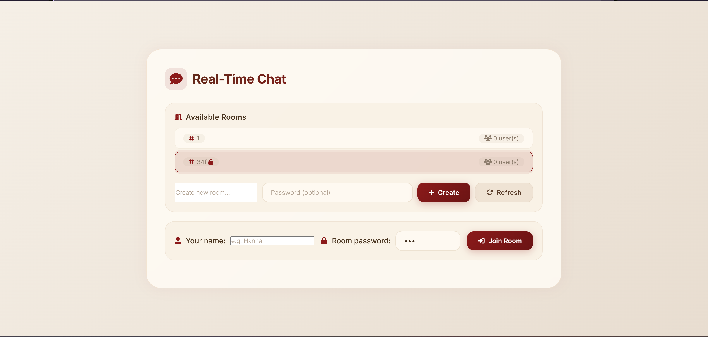
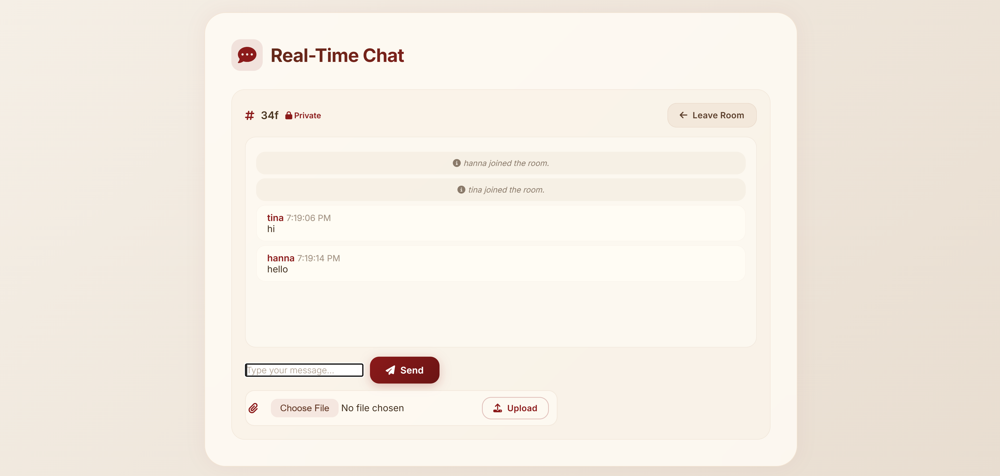

# 💬 سامانه چت بلادرنگ (Real-Time Chat Application)

یک سیستم گفتگوی آنلاین و آنی مبتنی بر وب با معماری مدرن، توسعه داده شده با فریم‌ورک قدرتمند **FastAPI** و پروتکل ارتباطی **WebSockets** در بک‌اند و فرانت‌اند واکنش‌گرا با رابط کاربری شیشه‌ای (Glassmorphism).

---

> [!IMPORTANT]
> ### 🌐 مشاهده نسخه آنلاین (Live Demo)
> برای مشاهده و آزمایش پروژه به صورت زنده در محیط ابری، روی پیوند زیر کلیک نمایید:
> 
> 🔗 **[مشاهده دمو زنده پروژه روی رندر (Live Demo)](https://chat-real-time.onrender.com)** `[لینک_دمو_روی_رندر]`
> 
> ⚠️ **نکات بسیار مهم قبل از ورود به دمو:**
> 1. **کاربران داخل ایران:** به دلیل فیلترینگ و تحریم‌های میزبانی ابری (Cloudflare/Render)، حتماً از **فیلترشکن (VPN)** فعال و پایدار استفاده کنید.
> 2. **زمان بارگذاری اولیه (Cold Start):** با توجه به میزبانی روی پلن رایگان سرور Render، چنانچه سرویس مدتی غیرفعال بوده باشد به حالت Sleep رفته و راه‌اندازی اولیه آن حدود **۳۰ تا ۴۰ ثانیه** زمان می‌برد. لطفاً صبور باشید.

---

## 📸 تصاویر محیط برنامه (Screenshots)

| نمای لابی، فهرست اتاق‌ها و ورود (Lobby & Rooms) | محیط گفتگوی آنلاین و تبادل رسانه (Chat Interface) |
| :---: | :---: |
|  |  |

---

## 🔑 حساب‌ها و اتاق‌های پیش‌فرض جهت تست سریع

جهت تسهیل بررسی و ارزیابی پروژه، اتاق‌های پیش‌فرض زیر به همراه حساب‌های نمونه تعریف شده‌اند و نیازی به ساخت اتاق برای تست اولیه ندارید:

| نام اتاق (Room Name) | نوع اتاق (Type) | نام کاربری پیشنهادی (Username) | رمز عبور اتاق (Password) | سطح دسترسی و هدف تست |
| :--- | :---: | :--- | :--- | :--- |
| `general` | **عمومی (Public)** | `guest` یا `user1` | _ندارد (بدون رمز)_ | تست ارسال و دریافت سریع پیام و فایل |
| `vip-lounge` | **خصوصی (Private 🔒)** | `admin` | `admin123` | تست اعتبارسنجی رمز عبور و روم‌های قفل‌دار |
| _اتاق دلخواه_ | دلخواه (عمومی یا خصوصی) | هر نام کاربری یکتا | رمز دلخواه کاربر | تست ساخت اتاق جدید در لحظه |

> **نکته:** سیستم نیازی به ثبت‌نام طولانی ندارد؛ هر کاربر با وارد کردن یک نام کاربری (Nickname) دلخواه و غیرتکراری در آن اتاق می‌تواند بلافاصله وارد گفتگو شود.

---

## ✨ قابلیت‌های کلیدی (Key Features)

- ⚡ **ارتباط بلادرنگ دوطرفه (Full-duplex WebSocket):** ارسال و دریافت آنی پیام‌ها با تأخیر نزدیک به صفر بدون نیاز به رفرش یا Polling.
- 🔒 **پشتیبانی کامل از روم‌های خصوصی (Password-Protected Rooms):** امکان ساخت اتاق‌های اختصاصی با رمز عبور و اعتبارسنجی دو مرحله‌ای (REST قبل از اتصال + لایه حفاظتی داخل وب‌سوکت).
- 👤 **جلوگیری از نام‌های تکراری (Duplicate Nickname Prevention):** بررسی نام کاربری در سطح اتاق برای جلوگیری از تداخل هویت کاربران.
- 📁 **اشتراک‌گذاری مالتی‌مدیا و فایل‌ها:** آپلود امن انواع فایل‌های تصویری (`jpg`, `png`)، صوتی (`mp3`, `wav`)، ویدیو (`mp4`) و اسناد (`PDF`) با پیش‌نمایش مستقیم درون صفحه چت.
- 😃 **سیستم کدهای ایموجی (Emotes Parser):** جایگزینی خودکار کدهای پرکاربرد (مانند `:smile:`، `:heart:`، `:thumbsup:` و ...) با ایموجی‌های گرافیکی.
- 📢 **پیام‌های سیستمی هوشمند:** نمایش اعلانات ورود (`joined the room`) و خروج (`left the room`) اعضا.
- 🎨 **رابط کاربری مدرن و واکنش‌گرا (Glassmorphism & Responsive):** سازگار با موبایل، تبلت و دسکتاپ با استفاده از افکت‌های مدرن Blur و انیمیشن‌های نرم CSS.
- 🐳 **آماده‌سازی برای کانتینریزاسیون (Docker Ready):** پشتیبانی بومی از Docker و Docker Compose جهت استقرار بدون دردسر روی هر محیطی.

---

## 🛠️ تکنولوژی‌های استفاده‌شده (Tech Stack)

### بخش بک‌اند (Backend)
- **زبان:** [Python 3.10+](https://www.python.org/)
- **فریم‌ورک اصلی:** [FastAPI](https://fastapi.tiangolo.com/) (مبتنی بر ASGI، پرسرعت و بهینه‌سازی‌شده برای کارهای ناهمگام)
- **سرور وب:** [Uvicorn](https://www.uvicorn.org/) (سرور پرسرعت ASGI)
- **ارتباطات بلادرنگ:** Native Python WebSockets & wsproto
- **اعتبارسنجی داده‌ها:** [Pydantic v2](https://docs.pydantic.dev/)
- **مدیریت فایل‌ها:** `python-multipart` جهت دریافت استریم فایل‌ها

### بخش فرانت‌اند (Frontend)
- **تکنولوژی:** Pure HTML5, Modern CSS3, JavaScript (ES6+)
- **آیکون‌ها و فونت‌ها:** [FontAwesome 6.5](https://fontawesome.com/) و تایپوگرافی [Inter Font](https://fonts.google.com/specimen/Inter)
- **سبک طراحی:** Glassmorphism UI با پشتیبانی از سیستم مدال (Modal Viewer) برای مشاهده تمام‌صفحه فایل‌ها

### دواپس و زیرساخت (DevOps & Infrastructure)
- **کانتینرسازی:** [Docker](https://www.docker.com/) & Docker Compose
- **میزبانی ابری:** [Render Cloud Platform](https://render.com/)

---

## 📂 درخت ساختار فایل‌های پروژه (Project Tree)

```text
chat_real_time/
├── app/
│   ├── __init__.py
│   ├── main.py                     # نقطه ورود اپلیکیشن، کانفیگ CORS و بارگذاری روترها
│   ├── routers/
│   │   ├── __init__.py
│   │   ├── chat.py                 # روتر ارتباطات وب‌سوکت و برادکست پیام‌ها
│   │   ├── room.py                 # اندپوینت‌های REST لیست، ساخت و اعتبارسنجی اتاق
│   │   └── upload.py               # پردازش، فیلترگذاری فرمت و ذخیره فایل‌های مدیا
│   ├── schemas/
│   │   ├── __init__.py
│   │   ├── message.py              # اسکیماهای اعتبارسنجی Pydantic پیام‌ها
│   │   └── room.py                 # اسکیماهای ساخت، اطلاعات و اعتبارسنجی اتاق
│   └── services/
│       ├── __init__.py
│       └── connection_manager.py   # هسته مدیریت اتصالات فعال در حافظه (In-Memory)
├── screenshots/                    # تصاویر مستندات محیط برنامه
│   ├── 01-lobby.png
│   └── 02-chat.png
├── uploads/                        # دایرکتوری ذخیره فایل‌های آپلودی کاربران
│   └── .gitkeep
├── .dockerignore                   # لیست نادیده‌گیری فایل‌ها در ایمیج داکر
├── .gitignore                      # لیست فایل‌های غیرقابل پیگیری گیت
├── Dockerfile                      # دستورالعمل ساخت کانتینر اپلیکیشن
├── docker-compose.yml              # کانفیگ اجرای یکپارچه با Docker Compose
├── index.html                      # صفحه رابط کاربری مدرن (SPA)
├── README.md                       # مستندات جامع فنی و راهنمای پروژه
└── requirement.txt                 # فهرست بسته‌ها و پکیج‌های پایتون
```

---

## 🚀 راهنمای نصب و اجرای لوکال (Local Setup)

### پیش‌نیازها
- نصب بودن **Python 3.8+** (ترجیحاً پایتون 3.10)
- نصب بودن **Git**

### روش اول: اجرای دستی گام‌به‌گام

#### ۱. دریافت مخزن پروژه
```bash
git clone https://github.com/mhdds-codesign/chat_real_time.git
cd chat_real_time
```

#### ۲. ساخت و فعال‌سازی محیط مجازی (Virtual Environment)
- **در ویندوز (PowerShell / CMD):**
  ```powershell
  python -m venv venv
  .\venv\Scripts\activate
  ```
- **در لینوکس / مک:**
  ```bash
  python3 -m venv venv
  source venv/bin/activate
  ```

#### ۳. نصب وابستگی‌های پروژه
```bash
pip install -r requirement.txt
```

#### ۴. اجرای وب‌سرور توسعه
```bash
python -m uvicorn app.main:app --reload --host 127.0.0.1 --port 8000
```

اکنون مرورگر خود را باز کرده و به آدرس زیر بروید:
```
http://127.0.0.1:8000/
```

---

## 🐳 راهنمای اجرا با داکر (Docker Guide)

اگر تمایل دارید پروژه را به صورت ایزوله و کانتینری اجرا کنید، می‌توانید از داکر استفاده نمایید:

### روش اول: با استفاده از Docker Compose (ساده‌ترین روش)

تنها با اجرای یک دستور پروژه را بیلد و اجرا کنید:
```bash
docker compose up --build -d
```
برای توقف سرویس:
```bash
docker compose down
```

### روش دوم: با دستورات مستقیم Docker CLI

1. **ساخت ایمیج داکر:**
   ```bash
   docker build -t chat-real-time-app .
   ```
2. **اجرای کانتینر:**
   ```bash
   docker run -d -p 8000:8000 --name chat_app -v ${PWD}/uploads:/app/uploads chat-real-time-app
   ```

سرویس از آدرس `http://localhost:8000/` در دسترس خواهد بود.

---

## 🧪 تست سناریوی چت همزمان

برای آزمایش ویژگی‌های چت بلادرنگ:
1. مرورگر را باز کرده و در دو برگه (یا یک برگه عادی و یک برگه Incognito / Private) آدرس برنامه را باز کنید.
2. در برگه اول نام `UserA` و در برگه دوم `UserB` را وارد نمایید.
3. هر دو وارد اتاق `general` (یا اتاق رمزدار `vip-lounge` با پسورد `admin123`) شوید.
4. پیام‌های متنی، ایموجی‌ها (`:smile:`, `:heart:`) و یک فایل ارسال نموده و تبادل فوری اطلاعات را مشاهده فرمایید.

---

## 📄 لایسنس (License)

این پروژه تحت مجوز آزاد [MIT License](LICENSE) منتشر شده است.
